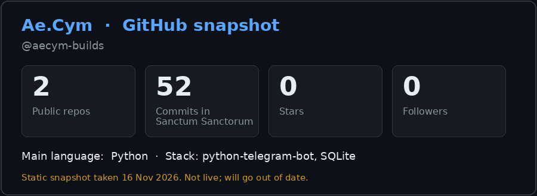

# Hi there, I'm Aseem 👋

**Ae.Cym** · Building whatever I need.

I'm a medical student from Rajahmundry who builds the tools I need — Telegram bots, automation, and Android tooling. I like owning what I build, end to end.

## 🔭 What I'm building

- **[Sanctum Sanctorum](https://github.com/aecym-builds/sanctum-sanctorum)** — a public Telegram file vault + AI assistant bot. Per-user private vaults, numbered retrieval, dedupe, categories, notes, links and reminders, with bring-your-own-key AI. Python, python-telegram-bot, SQLite.
- **Pinterest automation** — an official Pinterest API v5 connector for scheduling pins (in progress).

## 🛠️ Stack

Python · Telegram Bot API · SQLite · Git · Android (ADB, root, modding)

## 📊 Stats

*Static snapshot from 16 Nov 2026, not live.*

## 📫 Reach me

- Telegram: [@Hattori009](https://t.me/Hattori009)
